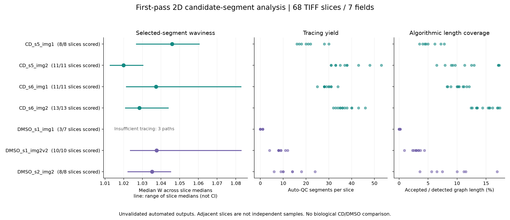

# Collagen fiber waviness analysis

An exploratory image-analysis prototype for quantifying collagen fiber waviness in dorsal mesentery SHG images. The goal is to reduce the manual tracing burden while retaining reviewable centerlines and explicit measurement definitions.

**Current status: numerical consistency checked; biological fiber tracing not yet validated.** The saved results describe selected two-dimensional candidate segments. They do not establish a CD-versus-DMSO biological difference.

## Start here

1. Read the [professor overview](docs/PROFESSOR_OVERVIEW.md) for the research question, current findings, and requested reference data.
2. Inspect the [representative trace overlays](results/representative_overlays.jpg), then the [validation and limitations](docs/VALIDATION.md).
3. Download [the interactive reviewer](https://github.com/yh0728-hhe/fiber-waviness-analysis/blob/main/report/review.html?raw=1) and open it in Safari or Chrome. GitHub's file preview does not execute the report. The downloaded HTML is self-contained and includes seven central slices. This compact viewer shows automatically retained and needs-review paths; all excluded paths remain in the compressed full snapshot.



The lines above show ranges of observed slice medians, not confidence intervals. Adjacent slices are repeated observations. The low-yield DMSO field is explicitly marked as insufficient tracing.

## What was measured

For each ordered centerline, waviness is **W = contour length / endpoint distance**. Straightness is the reciprocal **S = 1/W**. Both equal 1 for a straight trace. Lengths are in original-image pixels; physical calibration and XY spacing still need confirmation.

| Saved snapshot | Result |
|---|---:|
| TIFF slices / image fields | 68 / 7 |
| Automatically retained candidate segments | 1,592 |
| Candidate segments requiring review | 11,362 |
| Median accepted fraction of detected graph length | 8.96% |
| Numerical and synthetic software checks | 75 checks, 0 failures |
| Validation against expert real-image traces | Pending |

Automatic QC is a geometric filter, not confirmation of a complete or correctly identified fiber. The graph-length fraction includes noise in its denominator and is not biological recall. Fragmentation, missed junctions, smoothing, brightness, and segment-length selection affect the estimates. One DMSO field retained only three segments across seven slices. [Read the full audit](results/AUDIT_SUMMARY.txt).

## Results and code

- [Automatically filtered segment measurements](results/auto_qc_segments.csv), [per-image results](results/images.csv), and [field summaries](results/series_summary.csv).
- [All candidate paths](results/segments.csv.gz), [trace coordinates and report metadata](results/report_data.json.gz), and [all 68 preview/overlay/mask sets](results/images/).
- [Threshold sensitivity](results/threshold_sensitivity.csv), [synthetic checks](results/validation/validation_results.json), and [expanded consistency/smoothing audit](results/validation/audit_results.json).
- [Analysis source](src/analyze_fibers.py), [validation harness](src/validate_pipeline.py), [audit harness](src/audit_pipeline.py), and [report generator](src/build_review.py).

All 68 preview/overlay/mask sets are stored in [results/images/](results/images/). The [full candidate table](results/segments.csv.gz) and [full coordinate JSON](results/report_data.json.gz) use lossless gzip compression. A [smaller quick-review package](https://github.com/yh0728-hhe/fiber-waviness-analysis/blob/main/downloads/fiber-waviness-quick-review.zip?raw=1) contains the offline viewer, selected CSVs, figures, and summary. Download the entire repository with **Code → Download ZIP** or [this archive link](https://github.com/yh0728-hhe/fiber-waviness-analysis/archive/refs/heads/main.zip).

The image previews are contrast enhanced for display. The measured coordinates use original image dimensions. The reviewer separates automatic results from manual decisions and manual raw-polyline measurements.

## Run locally

Use **Python 3.12 or newer**. The recorded environment used Python 3.12.14. No NVIDIA GPU is required for this image-analysis pipeline.

```bash
python3 -m venv .venv
source .venv/bin/activate
python -m pip install -r requirements.txt
python run_pipeline.py --input-dir /path/to/extracted_training_data --output-dir runs/my_analysis
```

Use `python run_pipeline.py --help` for the supported workflow. New runs use a separate output directory and do not overwrite the supplied `results/` snapshot. Original raw TIFFs are required to repeat image extraction; the saved snapshot can be restored with `python unpack_snapshot.py` for a full audit of the recorded outputs.

To restore the two large saved files after downloading or cloning, run:

```bash
python unpack_snapshot.py
python src/audit_pipeline.py --base results --source-dir src
```

The unpacker verifies SHA-256 values and refuses to overwrite a different existing file.

## Next validation step

Compare a prespecified set of traces with knowledgeable annotators using the same fibers and endpoints. Record missed detections, false detections, splits, merges, waviness error, and review time. Confirm specimen IDs, pixel calibration, coverslip conditions, and biological independence before making treatment comparisons.

## Data provenance and sharing

This project includes laboratory image derivatives and numerical results. It does not include the original microscopy ZIP/TIFF/CZI files, correspondence, screenshots, or thesis PDF. [Data provenance](docs/DATA_PROVENANCE.md) identifies the input archive, unconfirmed labels, exclusions, and reuse considerations. No redistribution license for laboratory data is inferred.
